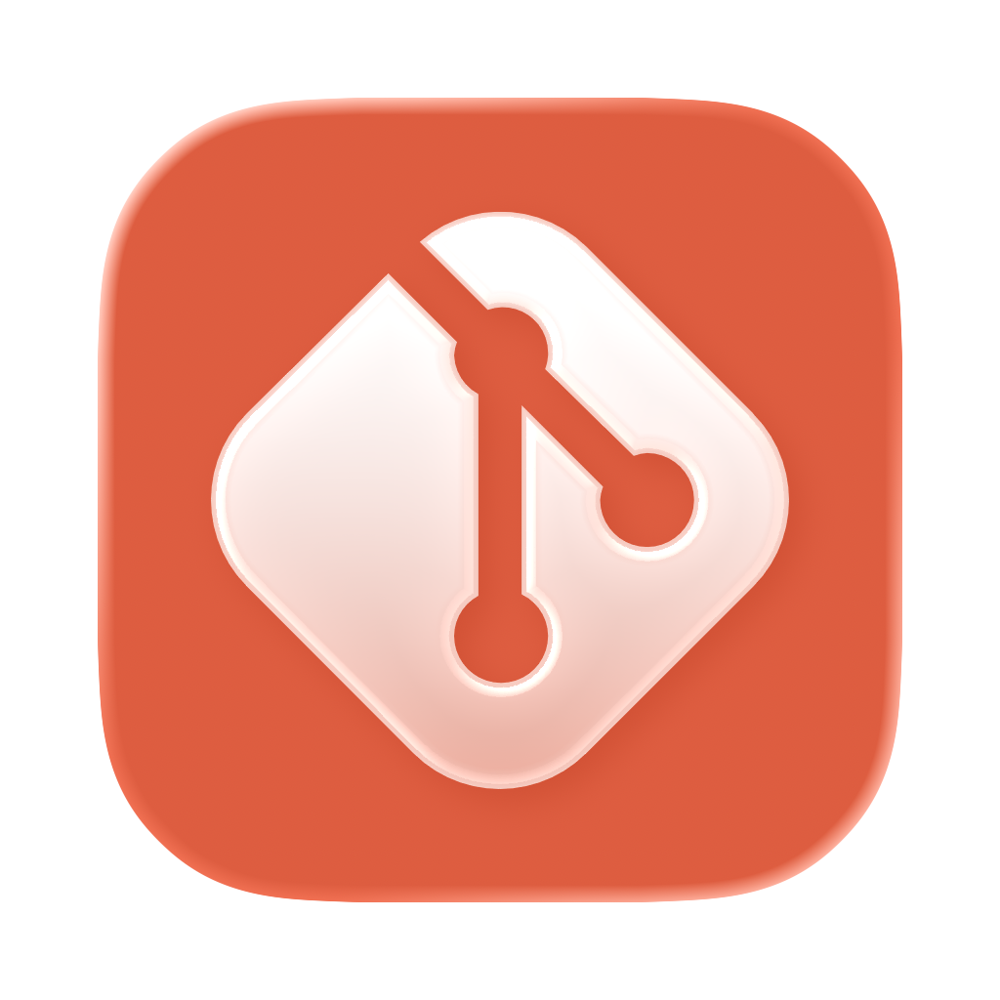
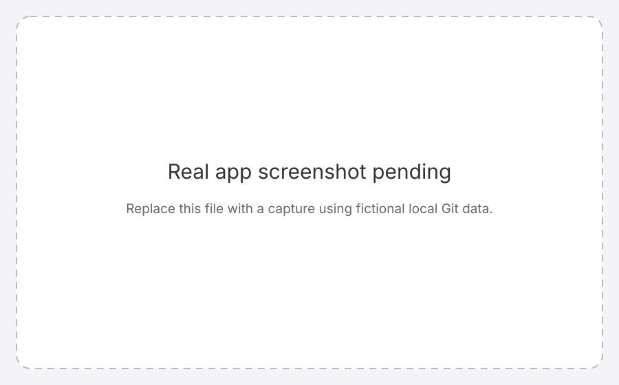

# GitBar

A macOS menu bar app for managing Git branches, worktrees, stashes, and GitHub pull requests.



*Screenshot placeholder, not a product image. See [capture instructions](docs/SCREENSHOT.md).*

## Install and update

### Homebrew

```sh
brew install --cask pedrotmr/git-bar/pedrotmr-git-bar
```

Homebrew manages updates for this copy. To update only GitBar, run:

```sh
brew update
brew upgrade --cask --greedy-auto-updates pedrotmr/git-bar/pedrotmr-git-bar
```

### Direct download

Download the latest stable `GitBar-<version>.dmg` or `.zip` from [GitHub Releases](https://github.com/pedrotmr/git-bar/releases/latest). Open the disk image and drag `GitBar.app` to Applications, or expand the ZIP and move the app to Applications.

Direct installs can use **Check for Updates…** in the app. Version 0.2.0 is the first Sparkle release. For a predictable upgrade from v0.1.x, install the current release manually once.

## First steps

Open GitBar from Applications and add a local Git repository. GitBar reads its local branches, worktrees, and stashes. The pull request view uses GitHub CLI (`gh`) and the account signed in with `gh auth login`.

## Requirements and limitations

- macOS 14.6 or later.
- Git is required. GitBar searches Homebrew and standard macOS locations when launched from Finder.
- GitHub CLI is optional. Install it with `brew install gh`, then run `gh auth login` to use pull requests. Your GitHub account must have access to each repository.
- GitBar runs Git commands against repositories you select. It does not host or synchronize repository data.
- Maintenance is limited. Issues and pull requests are welcome on a best-effort basis. Replies and release dates are not promised.

## Help and development

- **Questions and problems:** [GitHub Issues](https://github.com/pedrotmr/git-bar/issues)
- **Setup and development:** [Documentation index](docs/README.md) and [contribution guide](CONTRIBUTING.md)
- **License:** [MIT](LICENSE) · [Third-party notices](docs/THIRD-PARTY-NOTICES.md)
